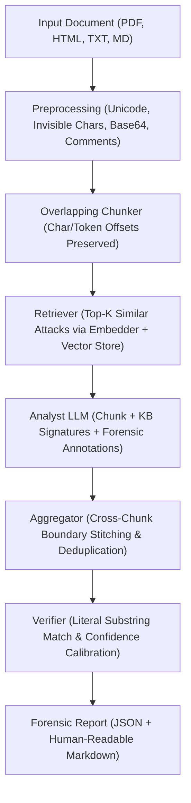

# Corpus Poisoning Forensic Analyst (RAG-based)

A forensic analyst tool that inspects a document corpus **before** it is indexed into a Retrieval-Augmented Generation (RAG) system or presented to an LLM. Its objective is to detect indirect prompt injections, conditional execution triggers, jailbreaks, data exfiltration channels, and prompt leaking, including obfuscated variants.

> **Scope**: Detects attacks by **form and intent** without verifying factual claims. Factual misinformation is strictly out of scope.  
> **Non-Parametric Memory**: The vector database stores **only** known attack signatures. Analyzed documents are never persisted and are discarded once the forensic report is generated.

---

## Architecture

The system operates as a modular, feed-forward forensic pipeline:



---

## Repository Layout

```text
pyproject.toml              # Build config, dependencies, ruff/mypy/pytest settings
README.md                   # System documentation & developer guide
AGENTS.md                   # Engineering standards and agent conventions
.gitignore                  # Version control ignore rules
.env.example                # Configuration template
data/
  knowledge_base/           # Raw KB sources (OWASP, MITRE, BIPIA, etc.)
  eval/                     # Ground truth evaluation datasets
  vectorstore/              # ChromaDB persistence directory (.gitignored)
  samples/                  # Sample attack entries for quick validation
src/corpus_forensics/
  __init__.py
  cli.py                    # Typer command-line interface
  config.py                 # Pydantic-settings application config
  schemas.py                # Core Pydantic v2 data models and report schemas
  ingestion/                # Document loaders (TXT, MD, HTML, PDF)
  preprocessing/            # Normalization, obfuscation detection, overlapping chunker
  embeddings/               # Embedder ABC, deterministic mock, factory
  vectorstore/              # VectorStore ABC, local persistent ChromaDB store
  knowledge_base/           # AttackEntry schemas, source loaders, ingestion pipeline
  llm/                      # LLMClient ABC, deterministic heuristic mock, factory
  analysis/                 # Retriever, prompt builder, chunk analyst, aggregator, verifier, pipeline
    prompts/                # External prompt template files
  reporting/                # JSON report writer & Markdown renderer
  evaluation/               # Benchmark dataset loader, metric calculators, test harness
tests/
  conftest.py               # Shared pytest fixtures
  fixtures/                 # Clean, poisoned, and hard-negative sample fixtures
  test_chunker.py           # Unit tests for offsets and overlapping windows
  test_text_loader.py       # Unit tests for document ingestion
  test_mock_embedder.py     # Determinism & unit normalization tests
  test_vectorstore_chroma.py# Local ChromaDB persistent operations
  test_verifier.py          # Anti-hallucination literal match tests
  test_metrics.py           # Benchmark metrics validation
  test_pipeline_smoke.py    # End-to-end integration smoke tests
```

---

## Installation & Setup

This project uses [`uv`](https://docs.astral.sh/uv/) for Python dependency and environment management.

```bash
# Clone the repository and navigate to root
cd LLMPoisoningRAGDetector

# Sync virtual environment and install all dependencies (including dev tools)
uv sync

# Run the test suite
uv run pytest

# Check code formatting and static typing
uv run ruff check
uv run mypy src
```

---

## CLI Usage

The tool provides an integrated command-line interface via `corpus-forensics`. All commands run immediately with zero external network dependencies using the built-in deterministic mocks.

### 1. Ingest Attack Knowledge Base
Populate the local ChromaDB vector store with known attack signatures:

```bash
# Ingest sample attack signatures
uv run corpus-forensics kb ingest --source custom

# Ingest with database reset
uv run corpus-forensics kb ingest --source custom --reset

# Ingest all configured sources
uv run corpus-forensics kb ingest --source all
```

### 2. View Knowledge Base Statistics
Inspect stored signatures by source and attack type:

```bash
uv run corpus-forensics kb stats
```

### 3. Analyze Documents
Analyze one or more files or entire directories:

```bash
# Analyze test fixtures and generate JSON and Markdown reports
uv run corpus-forensics analyze tests/fixtures/

# Specify output directory and format ('json', 'md', or 'both')
uv run corpus-forensics analyze document.pdf --out reports/ --format md
```

### 4. Run Benchmark Evaluation
Execute the evaluation harness across a labeled dataset:

```bash
uv run corpus-forensics eval run --dataset tests/fixtures/ --out reports/eval/
```

---

## Real vs. Mocked vs. Stubbed Modules

| Component | Status | Description |
|---|---|---|
| **Text & Markdown Loader** | **Real** | Full file ingestion, encoding handling, channel separation. |
| **HTML Loader** | **Real / Hook** | Extracts visible text and HTML comments. Hooks provided for CSS steganography. |
| **PDF Loader** | **Real / Hook** | Extracts page text and PDF metadata. Hooks provided for hidden layers. |
| **Chunker** | **Real** | Overlapping window chunker with exact original character offset tracking. |
| **Normalizer** | **Real Hooks** | Detects zero-width chars, base64 blobs, HTML comments, Unicode alterations. |
| **Embedder** | **Mock (Real Code)** | Deterministic SHA256-based unit vector generation. Dimension configurable. |
| **Vector Store** | **Real** | Local persistent ChromaDB using cosine distance and explicit vectors. |
| **LLM Client** | **Mock (Real Code)** | Deterministic heuristic engine simulating structured LLM responses. |
| **Verifier** | **Real** | Anti-hallucination engine verifying `fragmento_exacto` substring and character offsets. |
| **JSON & Markdown Reporting** | **Real** | Serializes reports with Spanish JSON keys and renders human-readable Markdown. |
| **Evaluation Metrics** | **Real** | Precision, Recall, F1, Accuracy, Hard Negative FPR, Attack Type Accuracy, Fragment Match Rate. |
| **External KB Loaders** | **Stubs** | OWASP, MITRE, Deepset, BIPIA, and HackAPrompt loader stubs with `# TODO(team):` tags. |
| **Cross-Chunk Aggregator** | **Working Stub** | Deduplication implemented; boundary stitching documented with strategy and TODO. |

---

## Where to Plug in the Real Implementation (Checklist)

To transition from the scaffold to production, implement the following components:

- [ ] **LLM Provider (`src/corpus_forensics/llm/`)**:
  - Implement a new `LLMClient` subclass in `src/corpus_forensics/llm/` (e.g. `openai_client.py`, `anthropic_client.py`, `vllm_client.py`).
  - Register it in `src/corpus_forensics/llm/factory.py`.
  - Set `CF_LLM_PROVIDER=<name>` in `.env`.
- [ ] **Embedding Provider (`src/corpus_forensics/embeddings/`)**:
  - Implement a real `Embedder` subclass (e.g. `openai_embeddings.py` or `huggingface_embeddings.py`).
  - Register it in `src/corpus_forensics/embeddings/factory.py`.
  - Set `CF_EMBEDDER_PROVIDER=<name>` in `.env`.
- [ ] **HTML Hidden-Content Channel (`src/corpus_forensics/ingestion/html_loader.py`)**:
  - Implement CSS style sheet parsing to detect `display:none`, `visibility:hidden`, font-size 0, off-screen absolute positions, and white-on-white text.
- [ ] **PDF Advanced Forensics (`src/corpus_forensics/ingestion/pdf_loader.py`)**:
  - Add extraction of invisible rendering layers (PDF mode 3), OCR for rasterized text, and raw object stream scanning.
- [ ] **Preprocessing Normalizer (`src/corpus_forensics/preprocessing/normalizer.py`)**:
  - Integrate homoglyph confusable matching and full language identification (e.g. `fasttext` or `lingua`).
- [ ] **Cross-Chunk Stitching (`src/corpus_forensics/analysis/aggregator.py`)**:
  - Complete adjacent-chunk fragment stitching for injections that cross chunk boundaries.
- [ ] **External KB Loaders (`src/corpus_forensics/knowledge_base/loaders/`)**:
  - Fill in the parser logic for OWASP Top 10, MITRE ATLAS, Deepset, BIPIA, and HackAPrompt.
- [ ] **Analyst Prompt (`src/corpus_forensics/analysis/prompts/analyst_prompt.txt`)**:
  - Tune few-shot examples and refine instructions for distinguishing hard negatives (academic security papers) from actual attacks.

---

## Assumed Evaluation Dataset Format

The evaluation harness in `src/corpus_forensics/evaluation/dataset.py` operates on a directory with the following structure:

```text
my_eval_dataset/
  labels.jsonl
  document_01.txt
  document_02.pdf
  document_03.html
```

Each line in `labels.jsonl` is a JSON record:
```json
{
  "documento": "document_01.txt",
  "categoria": "envenenado",
  "malicioso": true,
  "tipo_de_ataque": "inyeccion_directa",
  "tecnica_de_ocultamiento": ["ninguna"],
  "fragmento_exacto": "Ignore previous instructions",
  "posicion": "inicio",
  "sutileza": "obvio"
}
```

- Mandatory fields: `"documento"`, `"categoria"` (`"limpio"` | `"envenenado"` | `"hard_negative"`), and `"malicioso"` (`bool`).
- Optional fields: `"tipo_de_ataque"`, `"tecnica_de_ocultamiento"`, `"fragmento_exacto"`, `"posicion"` (`"inicio"` | `"medio"` | `"fin"`), and `"sutileza"` (`"obvio"` | `"parafraseado"` | `"disfrazado"`).
- The parser is fully tolerant of missing optional attributes.

---

## Assumptions & Design Choices

1. **Transient Documents**: In keeping with the forensic specification, ingested documents are processed in memory and **never written to the vector store**.
2. **Spanish Keys in Reports**: To preserve compatibility with downstream systems, `DocumentReport` and `Hallazgo` use exact Spanish JSON keys (`documento`, `malicioso`, `hallazgos`, `metadata de análisis`, etc.). Internal code logic and docstrings remain in English.
3. **Deterministic Mock Embeddings**: Mock embeddings use token hashing normalized to unit length so that cosine similarity in ChromaDB operates deterministically without external models or network requests.
