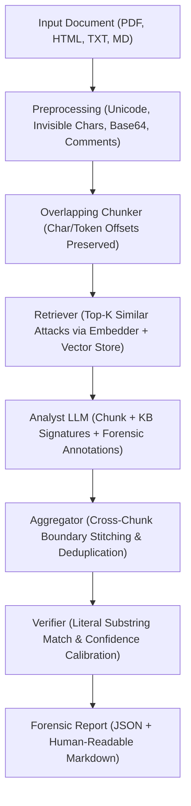

# Corpus Poisoning Forensic Analyst (RAG-based)

A forensic analyst tool that inspects a document corpus **before** it is indexed into a Retrieval-Augmented Generation (RAG) system or presented to an LLM. Its objective is to detect indirect prompt injections, conditional execution triggers, jailbreaks, data exfiltration channels, and prompt leaking, including obfuscated variants.

> **Scope**: Detects attacks by **form and intent** without verifying factual claims. Factual misinformation is strictly out of scope.  
> **Non-Parametric Memory**: The vector database stores **only** known attack signatures. Analyzed documents are never persisted and are discarded once the forensic report is generated.

---

## Architecture

The system operates as a modular, feed-forward forensic pipeline:



---

## Repository Layout

```text
pyproject.toml              # Build config, dependencies, ruff/mypy/pytest settings
README.md                   # System documentation & developer guide
AGENTS.md                   # Engineering standards and agent conventions
.gitignore                  # Version control ignore rules
.env.example                # Configuration template
data/
  knowledge_base/           # Raw KB sources (OWASP, MITRE, BIPIA, etc.)
  eval/                     # Ground truth evaluation datasets
  vectorstore/              # ChromaDB persistence directory (.gitignored)
  samples/                  # Sample attack entries for quick validation
src/corpus_forensics/
  __init__.py
  cli.py                    # Typer command-line interface
  config.py                 # Pydantic-settings application config
  schemas.py                # Core Pydantic v2 data models and report schemas
  ingestion/                # Document loaders (TXT, MD, HTML, PDF)
  preprocessing/            # Normalization, obfuscation detection, overlapping chunker
  embeddings/               # Embedder ABC, deterministic mock, factory
  vectorstore/              # VectorStore ABC, local persistent ChromaDB store
  knowledge_base/           # AttackEntry schemas, source loaders, ingestion pipeline
  llm/                      # LLMClient ABC, deterministic heuristic mock, factory
  analysis/                 # Retriever, prompt builder, chunk analyst, aggregator, verifier, pipeline
    prompts/                # External prompt template files
  reporting/                # JSON report writer & Markdown renderer
  evaluation/               # Benchmark dataset loader, metric calculators, test harness
tests/
  conftest.py               # Shared pytest fixtures
  fixtures/                 # Clean, poisoned, and hard-negative sample fixtures
  test_chunker.py           # Unit tests for offsets and overlapping windows
  test_text_loader.py       # Unit tests for document ingestion
  test_mock_embedder.py     # Determinism & unit normalization tests
  test_vectorstore_chroma.py# Local ChromaDB persistent operations
  test_verifier.py          # Anti-hallucination literal match tests
  test_metrics.py           # Benchmark metrics validation
  test_pipeline_smoke.py    # End-to-end integration smoke tests
```

---

## Installation & Setup

This project uses [`uv`](https://docs.astral.sh/uv/) for Python dependency and environment management.

```bash
# Clone the repository and navigate to root
cd LLMPoisoningRAGDetector

# Sync virtual environment and install all dependencies (including dev tools)
uv sync

# Run the test suite
uv run pytest

# Check code formatting and static typing
uv run ruff check
uv run mypy src
```

---

## CLI Usage

The tool provides an integrated command-line interface via `corpus-forensics`. All commands run immediately with zero external network dependencies using the built-in deterministic mocks.

### 1. Ingest Attack Knowledge Base
Populate the local ChromaDB vector store with known attack signatures:

```bash
# Ingest sample attack signatures
uv run corpus-forensics kb ingest --source custom

# Ingest with database reset
uv run corpus-forensics kb ingest --source custom --reset

# Ingest all configured sources
uv run corpus-forensics kb ingest --source all
```

### 1b. Knowledge Base Sources

The knowledge base is built from five public sources. Raw files are **not** committed
(the repository is public and HackAPrompt is gated); every teammate downloads them with:

```bash
uv run corpus-forensics kb download --source all   # no LLM calls, ~150 MB
uv run corpus-forensics kb ingest --source all --reset
```

| Source | Content | License | Entries loaded |
|---|---|---|---|
| [deepset/prompt-injections](https://huggingface.co/datasets/deepset/prompt-injections) | Injection prompts (EN/DE), `train` split only | Apache-2.0 | 203 |
| [BIPIA](https://github.com/microsoft/BIPIA) | Indirect-injection instructions, `train` categories only (test categories are reserved for evaluation) | MIT | 125 |
| [HackAPrompt](https://huggingface.co/datasets/hackaprompt/hackaprompt-dataset) | Successful competition attacks, deterministic sample stratified by level | MIT, gated: needs `CF_HF_TOKEN` | 400 |
| [MITRE ATLAS](https://github.com/mitre-atlas/atlas-data) | Prompt-injection techniques and real case-study steps, with official mitigations | Apache-2.0 | 55 |
| [OWASP LLM01/LLM07 2025](https://genai.owasp.org/llmrisk/llm01-prompt-injection/) | Example attack scenarios and prevention strategies | CC BY-SA 4.0 | 11 |

Entries are labeled by rules during `kb ingest` (`knowledge_base/labeling.py`, no LLM):

- **BIPIA** by category; its 25 task-irrelevant questions ("What is the capital of Brazil?")
  are dropped: they are attacks only by context.
- **deepset** and **HackAPrompt** by multilingual patterns (EN/DE/ES/FR/RU...) for
  instruction override, role-play, prompt leaking, exfiltration and planted triggers.
  deepset rows that plant a false "context" document are dropped (factual poisoning is out of
  scope), as are rows with no instruction aimed at the model. An *order* to fabricate ("write
  an untrue headline") is an injected instruction and is kept as direct injection, the same
  criterion BIPIA's "Misinformation & Propaganda" test category gets.
- **MITRE ATLAS** by technique ID and **OWASP** by scenario (`etiquetado: fuente`).
- Concealment is detected from the text: invisible Unicode, base64, HTML comments,
  non-Latin scripts, homoglyphs and character separation (the last two map to `otro`).
- Entries without objective or mitigation get a per-type profile citing OWASP / ATLAS.

Each entry records `etiquetado` (`reglas` | `fuente`), the `regla` that fired and its
`referencia`. A manual check of 80 random deepset/HackAPrompt entries found the attack type
right in ~95% and the concealment technique in ~90%; misses are creative obfuscations
(reversed text, "P+W+N+E+D") and conditional payloads, left for a later LLM labeling pass.

### 1b-bis. Embedders and Paid Calls

| `CF_EMBEDDER_PROVIDER` | What it is | Cost |
|---|---|---|
| `mock` | Hash vectors, no meaning (tests only) | Free |
| `local` (default) | `intfloat/multilingual-e5-small` via sentence-transformers, 384 dims, E5 `query:` / `passage:` prefixes | Free, ~470 MB download once |
| `litellm` | `text-embedding-3-small` through the course proxy | Paid, cached |

Changing the embedder changes the vector dimension: run `kb ingest --reset` and
`lit ingest --reset` afterwards. On a CPU, loading both collections takes about 3 minutes;
`lit ingest` without `--reset` resumes where it stopped.

Calls to the proxy stop the whole run at the first "no credit" answer (HTTP 429
`insufficient_quota`) instead of retrying; only transient errors (network, 5xx, real rate
limits) are retried, twice.

### 1b-ter. Defensive Normalization (preprocessing)

Each chunk gets a `normalized_text` (`preprocessing/normalizer.py::canonicalize`) that shows
what a model would actually read:

1. Unicode Tag characters (U+E0000-E007F, "ASCII smuggling") are revealed as a visible
   `[UNICODE_TAGS: ...]` marker.
2. Zero-width characters, bidi controls (Trojan Source) and variation selectors are removed.
3. NFKC folds fullwidth, circled and mathematical letters.
4. Cyrillic/Greek look-alikes inside Latin words are folded (subset of UTS #39 confusables);
   genuine Russian or Greek text is left untouched.
5. Decoded base64 blobs are appended as `[BASE64_DECODED: ...]`.

Retrieval searches with `normalized_text` (`CF_NORMALIZE_FOR_RETRIEVAL=true`, ablation flag)
and the analyst prompt shows it as a separate "normalized view". Findings must still quote
the original text, so offsets and verification are unchanged.

Observed so far: `multilingual-e5`'s tokenizer already applies NFKC, so step 3 alone does not
change its embeddings; the gain is expected on Unicode Tags, invisible characters, Cyrillic
homoglyphs and base64, and in what the LLM analyst gets to see. The current knowledge base
has few such examples (BIPIA's "Base Encoding" category asks the model to *answer* in
base64; it is not encoded text), so the effect has to be measured on the evaluation set.

### 1c. Literature Collection (papers and reports)

A second Chroma collection, `literatura`, holds passages from 27 high-priority papers and
technical reports that **explain** the attack types (NIST AI 100-2 E2025, OWASP LLM01/LLM07,
Greshake et al., PoisonedRAG, Jailbroken, Bad Characters, Spotlighting, etc.). The list,
with license and coverage per source, is versioned in
`data/knowledge_base/literature_sources.yaml`; the documents are downloaded locally and
never committed.

```bash
uv run corpus-forensics lit download        # 30 files (PDF + HTML), polite 3 s delay
uv run corpus-forensics lit build           # Docling -> markdown -> ~1,900 chunks of ~350 tokens
uv run corpus-forensics lit ingest --reset  # embeddings (~465k tokens, about USD 0.01)
uv run corpus-forensics lit stats
uv run corpus-forensics lit search "markdown image exfiltration"
```

- PDFs are converted with [Docling](https://github.com/docling-project/docling) (pure Python,
  no Docker; first run downloads its ~170 MB layout model). OCR and table-structure models
  are disabled: the papers are born-digital and their tables are mostly numeric results.
- Chunks never cross a section; references and acknowledgements are dropped; each chunk is
  embedded with a `title | section` header.
- The knowledge base is itself sanitized: Unicode Tag characters, zero-width and bidi
  controls are made visible, and chunks quoting literal payloads get `contiene_payload`.
- Each chunk carries keyword labels (`cubre_inyeccion`, `cubre_exfiltracion`, ...) and the
  source license class, so retrieval can filter by topic.
- Embeddings are cached in `data/cache/`, so re-ingesting never pays twice.

### 2. View Knowledge Base Statistics
Inspect stored signatures by source and attack type:

```bash
uv run corpus-forensics kb stats
```

### 3. Analyze Documents
Analyze one or more files or entire directories:

```bash
# Analyze test fixtures and generate JSON and Markdown reports
uv run corpus-forensics analyze tests/fixtures/

# Specify output directory and format ('json', 'md', or 'both')
uv run corpus-forensics analyze document.pdf --out reports/ --format md
```

### 4. Build the Evaluation Dataset

`eval build` generates the benchmark from pinned public texts and attacks the knowledge base
never saw (no LLM calls, deterministic for a given `--seed`):

```bash
uv run corpus-forensics kb download            # attack datasets (once)
uv run corpus-forensics eval build --out data/eval/v1 --seed 42
uv run corpus-forensics eval describe --dataset data/eval/v1
```

- **Clean texts**: Wikipedia articles (English and Spanish) at a fixed revision and project
  READMEs at a fixed commit, listed in `data/eval/sources.yaml`. Downloads are cached in
  `data/eval/cache/` (the Wikipedia User-Agent carries the repository URL, as Wikimedia asks).
- **Hard negatives**: passages of articles that *discuss* prompt injection and adversarial
  attacks (e.g. "Prompt injection", "Adversarial machine learning") without being one.
- **Poisoned documents**: a clean text with one attack inserted **verbatim** as its own visible
  paragraph at the start, middle or end. Attacks come only from held-out data: deepset `test`,
  BIPIA `test` (its categories differ from train; data-theft code snippets go into READMEs) and
  HackAPrompt successful attacks outside the knowledge-base sample. Nothing is paraphrased or
  obfuscated here; obfuscated cases are the ones that already come that way in the published data.
- **Selection**: stratified by attack type (`TYPE_QUOTAS`), round-robin over (source,
  concealment) buckets, dropping near-duplicates (same first 40 normalized characters).
- **Labels**: attack type and concealment come from the rule-based labeling; `fragmento_exacto`
  is the inserted text; `sutileza` is `disfrazado` when the attack carries a concealment technique.
  Extra provenance fields (`fuente_texto`, `fuente_ataque`, `id_ataque`, `regla_etiqueta`,
  `formato`, `idioma_texto`) are ignored by the harness but allow slicing.

Default composition (seed 42): 190 documents, 60 clean / 100 poisoned / 30 hard negatives;
direct injection 43, jailbreak 20, exfiltration 15, prompt leaking 12, conditional trigger 10;
37 of the 100 attacks are concealed. Known limitation: held-out data has few conditional
triggers and no plain-text exfiltration, so those slices are small. The generated folder is
git-ignored; rebuild it with the command above.

### 5. Run Benchmark Evaluation

```bash
# Retriever only: chunk + retrieve, no LLM calls, no cost
uv run corpus-forensics eval run --dataset data/eval/v1 --out reports/eval-retrieval --retrieval-only
# Full pipeline (LLM analysis per chunk)
uv run corpus-forensics eval run --dataset data/eval/v1 --out reports/eval
# Recompute metrics from a saved run without running the pipeline again (free)
uv run corpus-forensics eval metrics --predictions reports/eval/predictions.jsonl
```

Each run writes `predictions.jsonl` (label, report, what was retrieved per chunk, latency,
usage), `run_config.json` (models, K, chunking, commit, dataset seed, knowledge-base type
shares), `eval_summary.json` and `eval_summary.md`.

The metrics follow the RAG evaluation scheme of the course (class 11), mapped to this
system: *question* = the chunk under analysis, *context* = the retrieved knowledge-base
examples and literature passages, *answer* = the forensic finding, *ground truth* = the
dataset label. Everything is computed deterministically (no LLM judge).

| Class metric | Here | Needs the LLM |
|---|---|---|
| Context Precision@K | Class formula; a retrieved example is relevant when it has the labeled attack type. Also for literature passages (topic labels). | No |
| Context Recall | Share of the label's claims (attack type; concealment technique when there is one) supported by at least one retrieved example. | No |
| Ranking (MRR, NDCG) | Reciprocal rank of the first relevant example; NDCG@K. | No |
| Faithfulness | Share of a finding's checkable claims the context supports: fragment verbatim in the document, cited example actually retrieved, declared type equal to the cited example's. | Yes |
| Answer relevance | Our answer is a labeled classification, so it is measured against the ground truth: precision / recall / F1, macro-F1 by attack type, confusion matrix, fragment coverage (≥ 50% of the true fragment's character 5-grams). | Yes |
| Noise robustness / Negative rejection | False positive rate on hard negatives / on clean documents. | Yes |
| Information integration | Not applicable (one document at a time). | — |
| Cost | Latency (median, p95), chunks, calls, tokens, USD from the usage ledger. | — |

**Verdict policy.** A document is flagged when at least one finding has confidence ≥
`CF_VERDICT_THRESHOLD` (0.5), a verified fragment (`CF_VERDICT_REQUIRE_VERIFIED`) and a
minimum severity (`CF_VERDICT_MIN_SEVERITY`). The policy is written in each report's metadata.
The evaluation re-decides every document at thresholds 0.05–0.95 from the saved findings
(precision, recall, F1, false positive rates, best-F1 threshold, AUROC of the document
score), so the threshold is chosen from one LLM run without new calls.

**Mitigation sources.** Literature excerpts reach the analyst with a `REF` id; the analyst
cites the one that supports its mitigation in `fuente_mitigacion_id`. The pipeline resolves it
to title, section and URL (`fuente_mitigacion`) only when that passage was actually retrieved
for the chunk; an invented id stays unresolved and counts against faithfulness.

**Ablation study.** Variants are defined in `data/eval/ablations.yaml` (name, question,
reference variant `compare_to` and setting overrides); `eval ablation` runs each one into its own
folder and writes `ablation_summary.md` with every metric and its difference against the
variant's reference:

```bash
# retriever variants (free, no LLM calls)
uv run corpus-forensics eval ablation --retrieval-only --out reports/ablation-retrieval
# all variants with the real LLM; run `base` first so `sin_verificador` (same prompts)
# is answered from the LLM cache at no cost
uv run corpus-forensics eval ablation --only base --out reports/ablation
uv run corpus-forensics eval ablation --out reports/ablation
```

| Variant | Compared with | What changes | Question |
|---|---|---|---|
| `retriever_basico` | — | Embedding search only | Start of the incremental chain |
| `hibrido` | `retriever_basico` | + BM25 fused with RRF | Do the attacks' literal markers help? |
| `hibrido_reescritura` | `hibrido` | + query rewriting | Does focusing the query reduce dilution? |
| `base` | `hibrido_reescritura` | + reranking (default configuration, `rag_avanzado`) | What does the reranker add? |
| `rerank` / `reescritura` | `retriever_basico` | One technique alone | Does each technique help on its own? |
| `sin_normalizacion` | `retriever_basico` | Retrieval with the raw chunk text | Does the defensive normalization help disguised attacks? |
| `chunks_grandes` | `retriever_basico` | 1000-character chunks (overlap 200) instead of 500 | Is the attack diluted in larger chunks? |
| `sin_ejemplos` | `base` | No known-attack retrieval (`top_k=0`) | Does the RAG of examples improve the LLM alone? |
| `sin_literatura` | `base` | No literature retrieval | Does the literature help the analyst? |
| `sin_verificador` | `base` | No confidence penalty, verified fragment not required | How much precision does the anti-hallucination check add? |
| `prompt_sin_hard_negatives` | `base` | Prompt without the hard-negative policy and examples | Do the examples lower false positives on texts about attacks? |

Folders that already have results are skipped (`--force` re-runs them), so a paid run is never
repeated; `--summary-only` rebuilds the table. Variants marked `requires_llm` are skipped with
`--retrieval-only`. A run interrupted midway resumes from the last finished document
(`predictions.partial.jsonl`).

**Advanced RAG without an LLM** (knowledge base of known attacks only; each technique has its
own switch, all on by default):

- `CF_QUERY_REWRITE`: the whole chunk is always searched, and its most suspicious sentences are
  added as extra queries (`CF_QUERY_REWRITE_MAX_SENTENCES`, default 3), fused with RRF.
  Sentences are scored with the labeling patterns (instruction override, prompt leaking, role
  play, exfiltration, triggers, conditionals) plus URLs, base64, second-person address and code
  that reaches the network, files or processes; fenced code blocks are kept whole. It only
  focuses the search, it never decides anything.
- `CF_HYBRID_SEARCH`: BM25 over the knowledge-base texts next to the embedding search, fused
  with Reciprocal Rank Fusion (`CF_RRF_K`, default 60).
- `CF_RERANK`: a multilingual cross-encoder (`CF_RERANK_MODEL`, default
  `cross-encoder/mmarco-mMiniLMv2-L12-H384-v1`, ~470 MB, downloaded on first use) reorders a pool
  of `CF_RERANK_CANDIDATES` (20) candidates, reading the focused sentences; pairs are capped at
  256 tokens.

Final examples keep the cosine similarity to the whole chunk, so scores stay comparable across
configurations. Retriever results (190 documents, K = 3; *macro* = average over attack types,
each weighing the same, since 77% of the knowledge base is direct injection):

| Variant | Context Precision | CP macro | jailbreak | exfiltration | prompt leaking | trigger | Median latency / doc |
|---|---|---|---|---|---|---|---|
| `retriever_basico` | 0.603 | 0.420 | 0.44 | 0.58 | 0.12 | 0.00 | 0.13 s |
| `hibrido` | 0.652 | 0.506 | 0.64 | 0.56 | 0.12 | 0.28 | 0.14 s |
| `hibrido_reescritura` | 0.717 | 0.573 | **0.80** | **0.59** | 0.50 | 0.03 | 0.17 s |
| **`base`** (+ reranking) | **0.717** | **0.619** | 0.59 | 0.56 | **0.61** | **0.40** | 4.2 s |
| `rerank` alone | 0.557 | 0.382 | 0.36 | 0.43 | 0.17 | 0.03 | 4.2 s |
| `reescritura` alone | 0.604 | 0.440 | 0.39 | 0.41 | 0.44 | 0.00 | 0.16 s |

Each step of the chain raises the macro Context Precision (0.42 → 0.51 → 0.57 → 0.62). The
reranker alone hurts (it is trained for question answering, not for "same attack type"), but on
top of the other two it lifts the rarest types (trigger 0.03 → 0.40, prompt leaking 0.50 → 0.61)
at the cost of jailbreak. Latencies were measured on a 4-vCPU Linux VM; reranking is much faster
natively, and corpus inspection runs in batch before indexing.

Retriever scores are read against **chance levels** (what a random retriever would hit given
each type's share of the knowledge base: 77% of the examples are direct injection). The
report also includes a similarity-only baseline (AUROC of the document's top-1 similarity),
the class's action matrix (retriever score × generator score per attack type) and slices by
category, type, position, subtlety, concealment, format, language and attack source with
95% Wilson intervals. When the LLM is the mock, the report says so at the top.

---

### 6. Computational Cost and Token Usage

```bash
# measure the pipeline without calling the LLM (prompts are built and counted locally)
uv run corpus-forensics eval cost --sample 40 --out reports/cost
# read a saved run instead (e.g. one with the real LLM, to compare estimated vs measured)
uv run corpus-forensics eval cost --predictions reports/eval/predictions.jsonl --out reports/cost
```

`cost_report.md` (also section 5 of every `eval_summary.md`) reports:

- **Time per stage** (load, chunking, chunk embedding, example retrieval with its sub-stages
  - extra query embeddings, dense search, BM25, reranker -, literature retrieval, LLM,
  aggregation and verification): mean per document and share of the pipeline time.
- **Analyst prompt tokens**, counted with the model's tokenizer (`o200k_base` for
  gpt-4o-mini) and split by section: template, chunk, normalized view, retrieved examples,
  literature passages and the structured-output schema. Output tokens are assumed (120 per
  call) until a real run measures them from the usage ledger.
- **Cost projection** per document and per 1,000 / 10,000 documents for gpt-4o-mini,
  gpt-4.1-nano and gpt-4.1-mini, and the measured cost when there is one.
- **Resources**: peak memory, vector index size, embedding and reranker model sizes.

First measurement (40-document stratified sample, default configuration, 4-vCPU Linux VM):
the reranker takes 91% of the processing time (4.3 of 4.7 s per document; everything else
is under 0.5 s). Each analyst call carries ~2,600 input tokens, 67% of them fixed (template
37%, output schema 30%) and only 4% chunk text; with ~5 chunks per document the projected
cost is about USD 2.3 per 1,000 documents with gpt-4o-mini. Placing the fixed instructions
before the chunk would let the provider's prompt caching discount them.

### 7. Web Interface

```bash
uv run corpus-forensics ui          # opens http://localhost:8501
```

A Streamlit app to analyze one document (upload a TXT, Markdown, HTML or PDF file, or pick
one from the evaluation dataset, which also shows its ground-truth label). It shows the
verdict, the findings (type, severity, confidence, concealment, verified fragment, objective,
mitigation and its cited source), the document's visible text and hidden channel with the
findings highlighted, the examples retrieved for each chunk, and downloads the JSON and
Markdown reports. The sidebar toggles the Advanced RAG techniques and the verdict policy. A
second tab renders the evaluation, ablation and cost reports found under `reports/`.

---

## Module Status

| Component | Status | Description |
|---|---|---|
| **Text & Markdown Loader** | Real | File ingestion and encoding handling. |
| **HTML Loader** | Real | Visible text plus hidden channel: comments and elements hidden by the `hidden` attribute or CSS (inline and `<style>` rules: display/visibility, opacity 0, font-size 0, white or transparent text, off-screen, zero clip). |
| **PDF Loader** | Real | Character-level separation with pdfium: invisible render mode, transparent or white text, sub-1-pt glyphs and off-page text go to the hidden channel; document metadata too. |
| **Chunker** | Real | Overlapping windows with exact character offsets. |
| **Normalizer** | Real | Unicode Tags, invisible and bidi characters, NFKC, confusable folding, base64 decoding. |
| **Embedder** | Real | Local `multilingual-e5-small` (default), proxy `text-embedding-3-small`, or mock for tests. |
| **Vector Store** | Real | Local ChromaDB, cosine distance; collections `known_attacks` and `literatura`. |
| **Advanced retrieval** | Real | Query rewriting, BM25 + RRF hybrid search and cross-encoder reranking. |
| **LLM Client** | Real code, untested live | LiteLLM proxy with structured outputs, cache, usage ledger and budget cap; mock for offline runs. |
| **Aggregator** | Real | Deduplication and stitching of payloads cut by a chunk boundary. |
| **Verifier** | Real | Verbatim check in the visible and hidden channels; concealment tagging by hidden section. |
| **Verdict** | Real | Configurable policy (threshold, verified fragment, minimum severity). |
| **Knowledge base** | Real | 762 labeled examples (deepset, BIPIA, HackAPrompt, MITRE ATLAS, OWASP) and 1908 literature passages. |
| **Evaluation** | Real | 190-document held-out dataset, class 11 metrics, ablation study. |
| **Cost analysis** | Real | Time per stage, prompt tokens by section, cost projection, resources (`eval cost`). |
| **Web interface** | Real | Streamlit app (`corpus-forensics ui`). |

### Checklist

- [x] LLM provider (`llm/litellm_client.py`): pending only a live run with the course proxy.
- [x] Embedding provider (`embeddings/local_embedder.py`, `embeddings/litellm_embedder.py`).
- [x] HTML hidden-content channel (CSS rules and inline styles).
- [x] PDF hidden text (render mode, color, size, position). Not covered: text drawn under an
      opaque shape and OCR of rasterized text (would need full page rendering).
- [x] Normalizer: confusables folded. Language identification and base64 entropy checks were
      dropped on purpose: the embeddings are multilingual, non-Latin scripts are detected by
      the labeling rules, and base64 is decoded rather than scored.
- [x] Cross-chunk stitching. Not covered: payloads split across distant paragraphs.
- [x] External knowledge-base loaders.
- [x] Analyst prompt (hard negatives, untrusted-content rule, delimited references).

---

## Assumed Evaluation Dataset Format

The evaluation harness in `src/corpus_forensics/evaluation/dataset.py` operates on a directory with the following structure:

```text
my_eval_dataset/
  labels.jsonl
  document_01.txt
  document_02.pdf
  document_03.html
```

Each line in `labels.jsonl` is a JSON record:
```json
{
  "documento": "document_01.txt",
  "categoria": "envenenado",
  "malicioso": true,
  "tipo_de_ataque": "inyeccion_directa",
  "tecnica_de_ocultamiento": ["ninguna"],
  "fragmento_exacto": "Ignore previous instructions",
  "posicion": "inicio",
  "sutileza": "obvio"
}
```

- Mandatory fields: `"documento"`, `"categoria"` (`"limpio"` | `"envenenado"` | `"hard_negative"`), and `"malicioso"` (`bool`).
- Optional fields: `"tipo_de_ataque"`, `"tecnica_de_ocultamiento"`, `"fragmento_exacto"`, `"posicion"` (`"inicio"` | `"medio"` | `"fin"`), and `"sutileza"` (`"obvio"` | `"parafraseado"` | `"disfrazado"`).
- The parser is fully tolerant of missing optional attributes.

---

## Assumptions & Design Choices

1. **Transient Documents**: In keeping with the forensic specification, ingested documents are processed in memory and **never written to the vector store**.
2. **Spanish Keys in Reports**: To preserve compatibility with downstream systems, `DocumentReport` and `Hallazgo` use exact Spanish JSON keys (`documento`, `malicioso`, `hallazgos`, `metadata de análisis`, etc.). Internal code logic and docstrings remain in English.
3. **Deterministic Mock Embeddings**: Mock embeddings use token hashing normalized to unit length so that cosine similarity in ChromaDB operates deterministically without external models or network requests.
